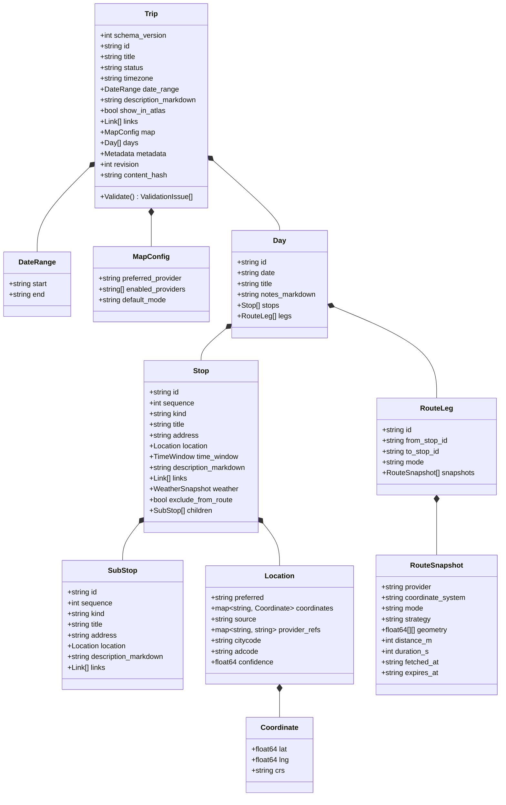
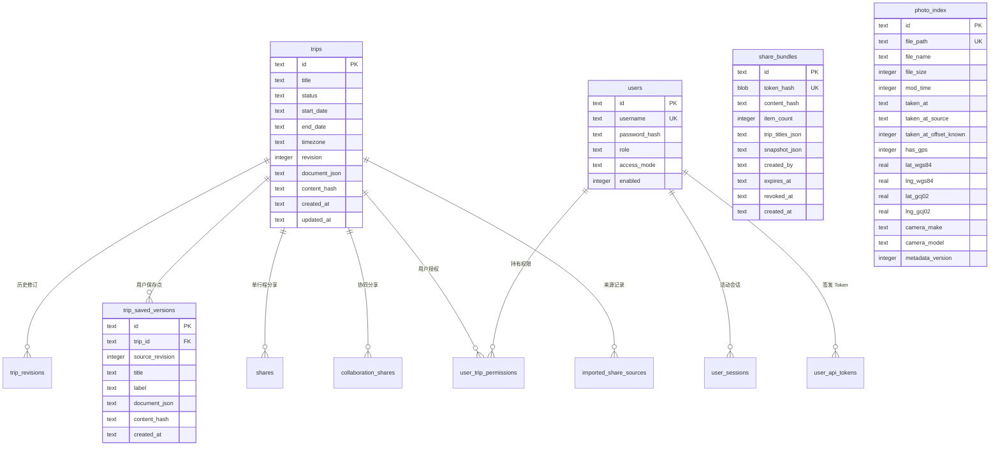
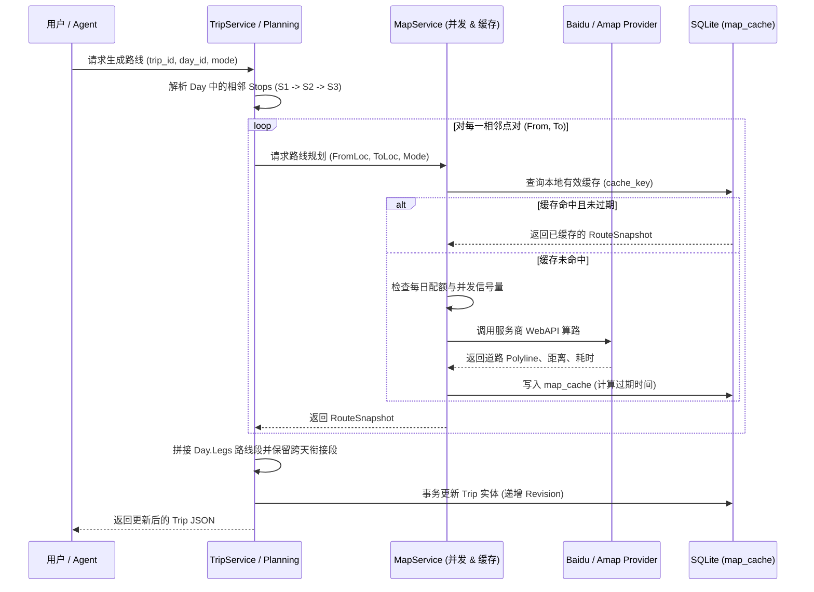
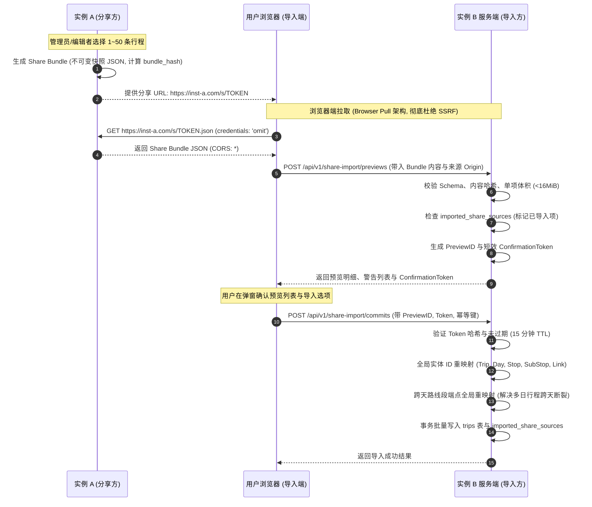

# JourneyIn 详细架构设计与实现细节文档

> **版本**：v0.7.4  
> **文档性质**：系统架构与实现权威参考手册  
> **适用对象**：核心开发人员、AI Agent、系统架构师及代码审查者

---

## 1. 项目定位与核心设计哲学

JourneyIn 是一套以地图为核心的旅行规划、浏览、协作、同步与跨实例分享系统。其设计哲学立足于以下五个核心原则：

1. **地图优先（Map-Centric Itinerary）**：
   旅行的本质是空间与时间的移动。行程规划不应退化为传统的扁平待办清单或单纯的富文本笔记，而是将地理点位、时间窗口、交通换乘路线、实时/历史气象、实地照片与备忘记录有机编织在同一张互动地图上。
2. **本地优先与数据主权（Local-First & Data Sovereignty）**：
   用户的行程资产属于用户自身。所有数据以标准化 JSON 和本地 SQLite 存储，不依赖任何中心化第三方商业云服务。在断网或无服务商 Key 的情况下，已规划的行程数据仍具备完全的离线查看与导出能力。
3. **零 CGO 单二进制交付（Zero-CGO Modular Monolith）**：
   生产发布坚持单一独立可执行文件，通过 Go 的 `go:embed` 特性将 Vue 3 SPA 前端产物、SQL 迁移脚本和 JSON Schema 统统嵌入二进制。选用纯 Go 实现的 SQLite 驱动（`modernc.org/sqlite`），在 `CGO_ENABLED=0` 下构建，实现跨 Linux、macOS、Windows（涵盖 amd64 与 arm64）真正的零系统动态库依赖交付。
4. **快照化分享与安全边界（Snapshot Sharing & Secure Isolation）**：
   分享分为单行程只读快照与多行程分享包（Share Bundle）。分享链接提供的是不可篡改的历史切片，源端的后续修改不会静默漂移到已分享页面。跨实例导入通过浏览器端中转拉取（Browser Pull），后端坚决不发起到对方实例的出站请求，杜绝 SSRF 风险。
5. **AI Agent 原生集成（MCP Native）**：
   原生集成模型上下文协议（Model Context Protocol，MCP），提供标准的 Streamable HTTP 和 stdio 双通道，遵循严格的两阶段验证提交（Validate -> Preview -> Confirm -> Commit）工作流，让 AI 可以精准、受控且幂等地完成复杂的行程编排。

---

## 2. 总体技术栈与运行时架构

### 2.1 技术选型全景

| 层次 | 选型 | 关键理由与运行约束 |
|---|---|---|
| **服务端语言** | **Go 1.24+** (固定 toolchain) | 并发安全、标准库健壮、编译速度快，交叉编译极其可靠。 |
| **架构风格** | **模块化单体 (Modular Monolith)** | 统一进程包含 REST API、静态资源托管、MCP Server、分享、离线同步与照片管理服务。 |
| **数据库** | **SQLite + `modernc.org/sqlite`** | 纯 Go 实现，无 CGO 依赖；强制开启 WAL 模式、忙等待超时（busy timeout）与迁移互斥锁。 |
| **前端框架** | **Vue 3 + TypeScript + Vite** | 组件化开发、强类型契约、成熟的中文生态与地图 JSAPI 适配能力。 |
| **UI 容器与组件** | **Ionic Vue + Capacitor** | 提供移动端抽屉、手势、弹窗与导航容器，同一套代码具备 Web、PWA 和 iOS/Android 打包能力。 |
| **视觉与样式** | **Material 3 语义设计令牌** | 自定义 CSS Variables 语义化管理，深浅色主题自适应，无第三方重度组件库包袱。 |
| **地图服务商** | **百度地图 + 高德地图** | 百度地图支持 JSAPI 4.0 与 BMapGL 回退；高德地图支持 JSAPI 2.0 与安全代理模式；抽象统一的 Provider 适配层。 |
| **气象服务商** | **Open-Meteo + 和风天气 + 彩云天气** | Open-Meteo 提供免 Key 开箱即用支持；和风与彩云提供高精度商业预报；支持地图附加气象。 |
| **协议标准** | **MCP (官方 Go SDK)** | 支持 2025-06-18+ 协议，提供 `/mcp` Streamable HTTP 与本地 CLI stdio 桥接。 |

### 2.2 技术选型权衡与方案比较 (Technology Selection & Trade-offs)

在项目架构初期，核心技术选型经过了详尽的多方案比对与权衡：

#### 2.2.1 服务端语言与运行时比对

| 方案候选 | 核心优势 | 未选为主方案的考量与权衡 |
|---|---|---|
| **Go (已选)** | **单一静态二进制**、跨平台交叉编译成熟、并发模型与 HTTP 标准库健壮；官方原生支持 MCP Go SDK；极佳的 SQLite 与静态资源嵌入能力。 | 前端仍需独立 Node 构建链；纯 Go SQLite 驱动需做好 WAL 并发与性能验证。 |
| Rust | 极高执行性能与底层内存安全；单二进制交付。 | 领域开发初期迭代成本高；地图 SDK、天气 API 适配及多端状态同步的胶水代码开发成本显著上升。 |
| .NET | ASP.NET Core 与 EF Core 企业级生态成熟。 | NativeAOT 体积较大，SQLite 原生动态库依赖在跨平台桌面与 Docker 容器中分发复杂度更高。 |
| Node.js / Bun | MCP 与前端 JSON 生态无缝整合。 | 生产发布依赖打包工具或宿主运行时，缺乏纯静态单二进制的运维分发优势。 |

**决策结论**：JourneyIn 定位为“可下载、可备份、易迁移的个人与家庭/小团队数字资产工具”，非高并发分布式微服务，Go 的运维交付优势和资源占用是最佳选择。

#### 2.2.2 前端与移动端跨平台方案比对

| 方案候选 | 核心优势 | 未选为主方案的考量与权衡 |
|---|---|---|
| **Vue 3 + Ionic + Capacitor (已选)** | **原生 Web 地图 JSAPI（百度/高德）无缝接入**；一套代码无缝覆盖 Web、PWA 与 iOS/Android；Ionic 提供完善的原生抽屉与触控容器。 | Ionic 默认视觉不等于纯正 Material 3，需通过设计令牌与 CSS 语义层进行定制。 |
| Flutter + Material 3 | Dart 统一多端，视觉一致性极强。 | 百度与高德首发提供的是 Web JSAPI，Flutter Web 嵌入复杂图层与覆盖物存在交互瓶颈，移动原生插件亦需分别维护两套。 |
| React + React Native | 移动原生生态强，部分 Web 逻辑可复用。 | 地图与核心视图在 Web 与 Native 之间仍需维护两套独立实现。 |

**决策结论**：采用 Vue 3 + Ionic Vue，视觉语言全面基于 Material 3 语义设计令牌定制。优先保障 Web 端地图与核心查看流极致流畅，移动端直接由 Capacitor 调用原生平台能力。

### 2.3 运行时拓扑架构

```mermaid
flowchart TB
    subgraph ClientLayer [客户端接入层]
        WebClient[Web 浏览器 / PWA]
        MobileClient[Capacitor Android / iOS App]
        ExtAgent[外部远程 AI Agent]
        LocalCLI[本地终端 / CLI Agent]
        PeerInstance[对端 JourneyIn 实例]
    end

    subgraph HostContainer [JourneyIn 单进程容器 / 二进制]
        direction TB
        
        subgraph Ingress [接入分发]
            HttpMux[HTTP Server Mux :8080]
            StdioBridge[MCP Stdio Bridge]
            SecurityMW[安全认证中间件 & 降权机制]
        end

        subgraph TransportLayer [传输层 (Transport)]
            RestAPI[REST API Handlers]
            McpServer[MCP Streamable HTTP Server]
            ShareServer[只读公开分享 /s/token]
            StaticFS[SPA 嵌入静态资源 (go:embed)]
        end

        subgraph ApplicationLayer [应用服务层 (Application)]
            TripService[行程管理与合并服务]
            MapService[地图调度与配额缓存]
            WeatherService[气象聚合与生命周期]
            BundleService[跨实例分享包服务]
            PhotoService[照片元数据与时空索引]
            UserService[用户权限与多租户]
            SyncEngine[变更追踪与同步引擎]
        end

        subgraph DomainLayer [核心领域层 (Domain)]
            TripRoot[Trip 聚合根]
            DaysStops[Day / Stop / Leg 实体]
            RouteTopo[路线拓扑与坐标系模型]
            Schemas[JSON Schema v1 规范]
        end

        subgraph StoreLayer [存储与适配层 (Adapters)]
            SQLiteStore[SQLite 数据访问对象]
            BaiduAdapter[百度地图适配器]
            AmapAdapter[高德地图适配器]
            WeatherAdapters[OpenMeteo / 和风 / 彩云适配器]
        end
    end

    subgraph DataStorage [持久化存储]
        DBFile[(SQLite /data/journeyin.db)]
        PhotoDisk[(宿主机照片目录 /photos)]
        CacheDisk[(本地缩略图缓存 /cache)]
    end

    subgraph ExternalCloud [外部公网 API]
        BaiduCloud[百度 WebAPI / JSAPI]
        AmapCloud[高德 WebAPI / JSAPI]
        WeatherCloud[第三方天气服务]
    end

    %% 连接关系
    WebClient -->|HTTP / WebSocket| HttpMux
    MobileClient -->|HTTP REST| HttpMux
    ExtAgent -->|Streamable HTTP /mcp| HttpMux
    LocalCLI -->|Standard I/O| StdioBridge
    PeerInstance -.->|浏览器跨端中转拉取| WebClient

    HttpMux --> SecurityMW
    SecurityMW --> RestAPI
    SecurityMW --> McpServer
    SecurityMW --> ShareServer
    SecurityMW --> StaticFS
    StdioBridge --> McpServer

    RestAPI --> ApplicationLayer
    McpServer --> ApplicationLayer
    ShareServer --> ApplicationLayer

    ApplicationLayer --> DomainLayer
    ApplicationLayer --> StoreLayer

    StoreLayer --> DBFile
    PhotoService --> PhotoDisk
    PhotoService --> CacheDisk
    StoreLayer --> ExternalCloud
```

---

## 3. 分层架构与代码组织

项目严格遵循洋葱架构（Onion Architecture）与端口适配器模式（Ports & Adapters），核心领域层不向外引用任何具体基础设施。

### 3.1 依赖约束与单向流动规则

```text
transport (httpapi, mcp)
    ↓
application (use-cases, coordination)
    ↓
domain (entities, aggregates, pure validation)
    ↑
store / maps / weather / photos (adapters & repositories)
```

- **`internal/domain`**：领域核心。仅包含 `Trip` 聚合根、`Day`、`Stop`、`RouteLeg` 实体定义、坐标系枚举、纯函数校验规则与内容哈希算法。**严禁引入** `net/http`、`database/sql`、地图 SDK 或前端组件。
- **`internal/application`**：应用用例编排层。处理用例事务、并发锁、业务校验（如两阶段提交、权限检查、实体 ID 重映射），不读取 HTTP 隐式全局变量。
- **`internal/store`**：持久化适配器。基于 SQLite 实现具体的 Repository 接口，管理事务、索引与 SQL 迁移。
- **`internal/maps` & `internal/weather`**：外部供应商端口与适配器。封装第三方 API 的并发控制、配额统计、坐标转换与模型映射。
- **`internal/photos`**：照片时空图集服务。负责扫描、EXIF 流式解析、缩略图生成与拍摄时间位置估算引擎。
- **`internal/transport/httpapi` & `internal/transport/mcp`**：输入适配器。处理 HTTP 编解码、会话状态、安全头注入、流式 MCP 协议处理与错误码映射。

### 3.2 目录映射与职责表

```text
JourneyIn/
├── cmd/journeyin/                  # 服务端入口 (CLI 参数解析、依赖装配、权限降权)
│   ├── main.go                     # 主函数、中间件链装配、优雅退出
│   ├── privilege_linux.go          # Linux 容器非 root 权限降权实现 (PUID/PGID)
│   └── privilege_other.go          # 其他平台的占位实现
├── internal/
│   ├── domain/                     # 领域模型与核心业务规则 (Trip, Day, Stop, Leg)
│   ├── application/                # 应用用例服务 (TripService, MapService, UserService)
│   │   ├── import_share_bundle.go  # 跨实例分享包两阶段导入与 ID 重映射
│   │   ├── planning.go             # 路线规划调度与拓扑分析
│   │   ├── stop_edit.go            # 规划点顺序调整与拖拽重排
│   │   └── trip_history.go         # 历史快照保存与安全恢复
│   ├── store/                      # 数据库适配器 (SQLite CRUD, 迁移管理, 索引)
│   ├── maps/                       # 地图服务适配器 (Baidu, Amap, NavigationURL)
│   ├── weather/                    # 气象服务适配器 (Open-Meteo, QWeather, Caiyun)
│   ├── photos/                     # 照片时空索引、EXIF 提取、时间位置估算
│   ├── collaboration/              # 多人协同编辑分享状态管理
│   ├── share/                      # 单行程与多行程只读快照分享服务
│   ├── security/                   # 安全凭据与主体模型 (Principal, Roles)
│   ├── sync/                       # 离线增量同步协议与变更追踪
│   └── transport/
│       ├── httpapi/                # REST API、静态托管、安全代理、中间件
│       └── mcp/                    # MCP 协议服务 (Streamable HTTP, stdio, 工具集)
├── migrations/                     # 数据库版本化 SQL 迁移脚本 (001_~013_)
├── schemas/                        # JSON Schema 规范定义 (trip.v1.json)
├── web/                            # 前端项目 (Vue 3, TypeScript, Vite, Ionic)
│   ├── src/
│   │   ├── App.vue                 # 前端主页面壳与核心状态调度
│   │   ├── RouteTopologyMap.vue    # 地图与路线拓扑渲染组件
│   │   ├── ShareTransferDialog.vue # 统一导入与分享 Action Sheet
│   │   ├── ShareBundleDialog.vue   # 多行程批量分享包弹窗
│   │   ├── ShareImportDialog.vue   # 跨实例分享包两阶段导入弹窗
│   │   └── styles.css              # Material 3 设计系统语义令牌
├── mobile/                         # Capacitor 原生移动包装配置
├── Dockerfile                      # 多阶段跨架构构建脚本
└── VERSION                         # 全局单一版本号真实源
```

---

## 4. 核心领域模型与规范化数据契约

JourneyIn 采用规范化的版本化 JSON 文档作为核心数据交换协议。规范版本固定为 `schema_version: 1`，对应模式文件为 `schemas/trip.v1.json`。

### 4.1 聚合根与实体关系模型



### 4.2 坐标系体系与显式约束（Coordinate Reference Systems）

空间地理数据绝不脱离参考系独立存在。系统在领域层明确区分并严格校验三种坐标参考系（CRS）：

1. **`wgs84`**：标准地球坐标系（GPS 原始数据、OpenStreetMap、Open-Meteo 使用）。
2. **`gcj02`**：国家测绘局国测局坐标系（火星坐标系，高德地图 API、腾讯地图及国内卫星定位使用）。
3. **`bd09ll`**：百度经纬度坐标系（在 GCJ-02 基础上再次非线性加偏，百度地图 JSAPI/WebAPI 专用）。

**强制设计约束**：
- 严禁通过数值范围猜测坐标系。任何传入的点位必须由 Location 对象包含显式的 `crs` 标记。
- 坐标转换仅在 `internal/maps` 适配边界显式进行（采用业内经久验证的克拉索夫斯基椭球偏转算法）。
- 路线段 Polyline 中的点列数据（`geometry`）强绑定所在的 `coordinate_system`，切换地图 Provider 底图时，必须基于对应的坐标系重新投影或请求算路，禁止把 BD-09LL 点列直接绘制在高德 GCJ-02 底图上。

### 4.3 实体标识与并发控制

- **稳定标识符**：所有实体均使用客户端可生成的全局唯一 ID（基于 `trip_`、`day_`、`stop_`、`leg_` 前缀配合强随机熵生成，未来向 UUIDv7/ULID 对齐），严禁使用数据库自增自增 ID 作为跨设备业务凭证。
- **乐观锁控制**：`trips` 表维护单调递增的 `revision`。所有更新（REST PUT/PATCH 或 MCP 操作）必须提供 `expected_revision`，版本不一致立即返回 `409 Conflict`，彻底拒绝静默最后写入覆盖（Last-Write-Wins）。
- **内容完整性哈希**：对规范化 JSON 进行 SHA-256 哈希计算得出 `content_hash`，用于版本校验、幂等判定、快照比对及导入去重。

---

## 5. 数据库与持久化层设计

系统持久化采用纯 Go 编译的 `modernc.org/sqlite`。无外部数据库服务器依赖，单文件便携性极高。

### 5.1 SQLite 核心运行配置

- **Journal 模式**：强制启用 `PRAGMA journal_mode = WAL`（Write-Ahead Logging），大幅提升并发读写吞吐，读操作不阻塞写，写操作不阻塞读。
- **忙等待超时**：`PRAGMA busy_timeout = 5000`，在锁竞争时自动休眠等待最多 5 秒，避免抛出瞬态 `database is locked` 错误。
- **外键约束**：强制开启 `PRAGMA foreign_keys = ON`，级联删除（CASCADE）由数据库引擎内部可靠保证。
- **安全迁移互斥**：应用启动时基于 `sqlite3_exec` 单连接互斥执行 `migrations/*.sql` 脚本，通过事务锁与版本游标保证并发启动时的安全幂等。

### 5.2 数据库 Schema 演进全集

系统共历经 13 次结构迁移，各表职责如下：



#### 核心数据表详细清单

1. **`trips`**：主行程元数据与规范化 JSON 全量快照存储表。
2. **`trip_revisions`**：每次提交保存产生的底层版本日志。
3. **`idempotency_keys`**：两阶段写操作与 API 重试幂等键注册表（记录 scope、key、request_hash、response_json）。
4. **`shares`**：单行程只读公开快照表（存储 128 位随机 token 的 SHA-256 哈希值、固化 JSON 及到期时间）。
5. **`share_bundles`**：多行程批量分享包表（包含多行程打包快照、创建者、标题数组、到期时间，**撤销时执行硬删除**）。
6. **`imported_share_sources`**：跨实例导入行程防重来源记录表（主键为 `source_origin + source_trip_id + content_hash`）。
7. **`collaboration_shares`**：协同编辑短效凭据表。
8. **`trip_saved_versions`**：用户主动打标命名的历史回滚检查点表。
9. **`trip_saved_version_tombstones`**：历史版本删除墓碑表（支持增量同步同步删除状态）。
10. **`map_cache` & `map_request_usage`**：外部地图 API 结果哈希缓存与每日调用限额计数表。
11. **`place_directory`**：POI 逆地理与地点检索结果本地目录。
12. **`photo_index`**：用户本地照片的 EXIF、时空坐标与置信度索引表。
13. **`users` / `user_trip_permissions` / `user_sessions` / `user_api_tokens`**：用户鉴权、会话管理、多租户行程 ACL 与长效 API 令牌表。
14. **`app_settings`**：系统级运行时设置（地图 Key、首选项、气象源配置、照片目录等）。

---

## 6. 核心子系统详细设计与实现细节

### 6.1 地图抽象与拓扑路线规划引擎（Map & Routing Engine）

JourneyIn 将地图能力抽象为标准领域接口 `journeymaps.Provider`，抹平了百度地图与高德地图在坐标系、数据格式与 HTTP 接口间的差异。



#### 关键技术实现细节：
- **相邻分段与多日跨天衔接**：
  路线并非全量点单次调用算路，而是按相邻规划点对切分成独立的 `RouteLeg`。对于跨天行程（Day N 与 Day N+1），系统在 `PlanTrip` 时自动探测并将 Day N 的最后一个主规划点与 Day N+1 的第一个主规划点建立跨天路线段（Cross-Day Leg），保存在 Day N+1 的 Legs 中。
- **排除点标记（`ExcludeFromRoute`）**：
  当某些规划点（如中途住宿点、不在行车主线上的备忘点）设置了 `exclude_from_route: true` 时，算路引擎自动在拓扑中将其绕过，直连其前后点，但在前端地图与时间线上仍然保留其标记展示。
- **高德 JSAPI 安全代理（`/_AMapService/`）**：
  高德 JSAPI v2.0 强制要求配置 Web 端安全密钥。为避免在客户端前端代码中泄露 `securityJsCode`，服务端内建了 `/_AMapService/` 代理网关，自动校验 Origin，补齐安全凭据并双向转发。
- **统一导航跳转生成器（`NavigationURL`）**：
  统一处理向外部地图 App 或 Web 导航跳转的 URL 生成。自动识别目标坐标系，针对移动端（Android/iOS）先尝试调起对应 App 的原生 scheme（如 `baidumap://` 或 `iosamap://`），在未安装时平滑降级到官方 HTTPS Web 导航页。
- **高对比度双层轨迹线与卫星图自适应（Route Casing & Satellite Adaptive Contrast）**：
  为彻底解决卫星底图模式下大面积绿色地表（如草原、森林、湿地）导致轨迹线融入背景的问题，系统实现了工业级双层描边（Casing/Halo）与色彩自适应体系：
  1. **双层描边结构**：高德通过原生 `isOutline`、百度通过底层叠加底色线，在主线外侧铺设隔离光环。标准图使用纯白微边（`#ffffff`），卫星图使用深色底边（`#0f172a`），实现全地形全地貌边缘立体隔离。
  2. **多预设色彩主题与互补色自适应**：提供经典青绿（`#24695c`）、落日暖橙（`#ff6b35`）、极光天蓝（`#0284c7`）、探险洋红（`#e11d48`）四套主题。处于卫星底图时，偏绿色系自动切换为与草原绿色互补的落日暖橙，彻底避免视觉疲劳与丢失轨迹。
  3. **图层联动即时渲染**：切换标准图与卫星图时触发视口保持的就地动态重绘，无感完成配色与描边切分。

---

### 6.2 统一气象聚合服务（Weather Subsystem）

行程规划不仅需要地理路线，还需要沿途各站点的气候预报。系统设计了解耦的 `weather.Service`。

- **多源数据提供者**：
  1. **Open-Meteo Provider**：完全开源免费、免 API Key，适合开箱即用，支持全球 7~16 天基础温度、降水概率与天气现象。
  2. **QWeather（和风天气）Provider**：国内高精商业气象源，支持分钟级天气、灾害预警、空气质量与多日预报。
  3. **Caiyun（彩云天气）Provider**：国内领先的分米级降雨预报与多日实况气象源。
  4. **地图附加天气适配器**：支持复用已配置的百度/高德地图气象接口作为候补数据源。
- **时区与本地日期敏感**：
  所有的气象快照（`WeatherSnapshot`）严格绑定所属规划点的 `LocalDate` 与行程的 `Timezone`。查询时根据经纬度与时间点自动映射，超过预报窗口期的历史行程或远期规划，明确标记 `available: false` 并展示过期状态，绝不编造虚假天气。
- **批量并发聚合（`refreshTripWeatherBatch`）**：
  支持一键扫描全程所有地点的天气状态，由服务端受控并发抓取并写入规划点的 `weather` 字段中，有效避免前端频繁并发触发外部气象接口限流。

---

### 6.3 照片时空图集与拍摄时间位置估算（Photo Atlas & Spatiotemporal Matching）

JourneyIn 提供内建的本地相册足迹地图（Photo Atlas），能够索引本地海量照片并将足迹呈现在地图上。

```mermaid
flowchart TD
    Scan[扫描照片目录] --> ReadEXIF[读取 EXIF 元数据]
    ReadEXIF --> CheckGPS{是否包含 GPS 坐标?}
    
    CheckGPS -->|是: has_gps = 1| SaveReal[写入数据库: GPS 真实锚点]
    CheckGPS -->|否: has_gps = 0| CheckTime{是否具备可靠拍摄时间?}
    
    CheckTime -->|否: 仅文件修改时间| Drop[不参与推断, 标记未知]
    CheckTime -->|是: EXIF DateTimeOriginal| SaveMissing[写入数据库: 待匹配照片]

    subgraph MatchingEngine [时空推断匹配引擎]
        direction TB
        Group[分组隔离: 同相对目录 + 同相机品牌型号 + 同时钟偏移基准]
        FindAnchors[提取该组内所有真实 GPS 锚点]
        WindowFilter[筛选指定窗口内的锚点: 15/30/60/120 分钟]
        AmbiguityGuard{前后锚点空间距离 > 300m ?}
        AcceptMatch[采用最近锚点坐标, 打标 time_match, 记录时间差]
        RejectMatch[放弃估算, 保持无坐标状态]

        Group --> FindAnchors
        FindAnchors --> WindowFilter
        WindowFilter --> AmbiguityGuard
        AmbiguityGuard -->|否| AcceptMatch
        AmbiguityGuard -->|是 (存在空间歧义)| RejectMatch
    end

    SaveMissing -.-> MatchingEngine
```

#### 核心推断算法与安全保护边界：
1. **严格的拍摄时间置信度前置要求**：
   - 坚决**排除**操作系统文件修改时间（`ModTime`），因为文件复制、下载、网盘同步都会篡改该时间。
   - 仅信任 EXIF 规范标签：`DateTimeOriginal`（原始拍摄时间）和 `DateTimeDigitized`（数字化时间）。
   - 解析 EXIF `OffsetTimeOriginal` / `OffsetTime` 时区偏移，精准记录 `taken_at_offset_known`。
2. **多维严格隔离分组（Grouping Isolation）**：
   - 仅在相同子目录（同一旅行批次）、相同相机品牌与型号（同设备时钟）、相同时间来源与相同偏移可信度的照片集合内寻找锚点，彻底防止家庭成员多设备时钟不同步导致的交叉错位。
3. **真实单向锚点（Ground-Truth Anchors Only）**：
   - 锚点照片必须是原生硬件录入经纬度的照片（`has_gps = 1`）。推断出来的估计点**绝不**作为二次推断的锚点，严格禁止级联推断。
4. **空间防歧义保护机制（Spatial Ambiguity Guard）**：
   - 如果目标照片前后两侧在时间窗口内均找到了真实 GPS 锚点，算法会计算前后锚点之间的空间距离（哈弗辛公式 Haversine）。
   - **硬性约束**：若两锚点间距超过 **300 米**，说明拍摄者在此期间处于高速移动或跨越复杂路段中，无法准确估算中间某时刻的具体位置，算法强制拒绝推断，避免在地图上产生严重偏离的错误标注。
5. **非破坏性与可解释呈现**：
   - 原始文件和数据库字段不被篡改。仅在 Atlas 图集 API 响应时注入 `location_source = "time_match"` 与 `match_delta_seconds`。
   - 前端地图标注显示黄色聚簇与明显的“**估**”字徽标，点击详情明确提示“基于相距 X 分钟的拍摄位置估算”，让用户清晰知晓位置来源。

---

### 6.4 分享与跨实例导入子系统（Share & Cross-Instance Import）

JourneyIn 拥有业界领先的去中心化跨实例数据交换架构。



#### 关键实现细节：
- **浏览器端拉取架构（Browser Pull）防范 SSRF**：
  传统服务端导入往往由实例 B 后端发起 `curl` 请求抓取实例 A 的 URL，这极易引发内部网络探测与服务端请求伪造（SSRF）漏洞。JourneyIn 创新性地采用**浏览器端直接拉取**架构：实例 A 的 `/s/<token>.json` 开放 CORS；实例 B 的 Web 端直接在前端通过 `fetch(url, { credentials: 'omit' })` 拿到数据，再送入实例 B 本地 API 进行校验。实例 B 的后端完全不建立对外的出站网络连接。
- **跨日行程全局端点重映射算法**：
  导入他人行程时必须对所有 ID 重新分配 UUIDv7，防止跨设备冲突。针对多日行程中 Day N+1 路线段连接 Day N 终点与 Day N+1 起点的跨天情况，重映射算法采用**全行程两阶段扫描**：第一阶段遍历所有 Day，建立涵盖全程所有 Stops 的全局映射表 `stopIDs[oldStopID] = newStopID`；第二阶段再对所有 Legs 进行端点解析。对于外部被删减的孤立段（Orphaned Legs），算法安全跳过而不阻断导入。
- **撤销物理硬删除（Hard Deletion）**：
  多行程分享包支持一键撤销。系统坚决不采用软标记隐藏，而是直接在 `share_bundles` 表中执行物理 `DELETE`。一旦撤销，数据从数据库中彻底抹除，任何凭 token 的请求立刻返回 404，杜绝数据残留泄露。

---

### 6.5 版本历史、回滚与离线同步子系统（Saved Versions & Sync）

为保护用户的每一次灵感与编排，JourneyIn 建立了完善的历史快照机制。

1. **版本快照（`trip_saved_versions`）**：
   - 用户可随时为当前行程建立命名保存点（如“去草原前最终版”、“包车司机确认版”）。
   - 记录源版本号（`source_revision`）、全量文档 JSON 和内容哈希。同一行程相同内容的版本具备唯一索引约束，防止重复堆叠。
2. **安全恢复回滚（Safe Restore Workflow）**：
   - 当用户从历史版本恢复行程时，后端首先为当前编辑中的行程自动建立一个名为 `"恢复前自动备份"` 的历史快照。
   - 随后将选中的历史文档赋予新的 ID，以全新的递增 `revision` 写入 `trips` 表。此机制确保回滚操作自身完全可逆，绝不造成当前未保存工作的不可逆丢失。
3. **离线增量同步引擎（Sync Engine）**：
   - 针对各端独立数据库，记录 `sync_changes` 变更流水（包括 `change_id`、`device_id`、`base_revision`、`new_revision`、`hash`）。
   - 提供 `GET /api/v1/sync/pull`（基于游标）与 `POST /api/v1/sync/push`（基于变更集），支持断网离线编辑，网络恢复后双向合并。

---

### 6.6 用户鉴权、多租户与权限体系（User Management & Security）

系统支持从极简单机到家庭/小团队多用户的平滑扩展。

- **双轨认证策略**：
  - **Localhost 开发者友好模式**：当服务监听在 `127.0.0.1` 本地且未配置环境变量密码时，免除强制登录，直接作为 System 本机管理员运行。
  - **远程绑定强制防护**：当服务监听在非回环地址（如 `0.0.0.0`）时，启动时强制检查认证凭据；若未配置密码或 Token，服务拒绝启动，杜绝裸奔暴露在公网。
- **用户角色与三级访问模式**：
  - **角色（Role）**：`admin`（管理员，拥有系统设置、用户管理、全量分享创建权限）与 `user`（普通用户）。
  - **访问模式（Access Mode）**：
    1. `read_only`：仅可查看系统内行程，无任何写权限。
    2. `selected_trip_edit`：仅对在 `user_trip_permissions` 表中显式授权的行程具备编辑权，其他行程只读。
    3. `all_trips_edit`：对所有行程具备编辑权。
- **凭据治理**：
  - 密码使用带随机盐的 **PBKDF2-HMAC-SHA256** 单向哈希存储。
  - 登录会话签发 24 小时有效的 **HttpOnly**、**SameSite=Lax** Cookie。
  - 支持签发 90 天有效的用户级 API Token，数据库仅持久化 Token 原文的 SHA-256 哈希值，原文仅在创建时向用户展示一次。

---

### 6.7 Model Context Protocol (MCP) 原生集成

JourneyIn 服务端原生实现了 Anthropic 发起的 MCP 协议，成为连接大语言模型与实体旅行世界的核心桥梁。

#### 核心 MCP 工具体系清单：

| MCP 工具名 | 关键参数 | 职责与安全语义 |
|---|---|---|
| `journeyin.get_capabilities` | (none) | 握手探测，返回支持的 Schema 版本、地图 Provider 清单与合并补丁能力。 |
| `journeyin.validate_trip` | `trip_json` | 纯内存只读校验，返回字段路径级错误/警告列表与摘要，**无写副作用**。 |
| `journeyin.preview_save_trip` | `trip_json`, `operation`, `target_trip_id`, `expected_revision`, `patch` | **两阶段写第一阶段**：创建短效预览，校验乐观锁与哈希，生成 `confirmation_token`。支持 `create`、`replace` 与局部 `merge`。 |
| `journeyin.commit_save_trip` | `preview_id`, `confirmation_token`, `idempotency_key` | **两阶段写第二阶段**：校验确认令牌与幂等键，原子提交写入数据库。 |
| `journeyin.plan_trip` | `trip_id`, `expected_revision`, `provider`, `mode`, `day_id` | 针对指定行程自动生成相邻点与跨天道路路线 Polyline 并固化。 |
| `journeyin.refresh_routes` | `trip_id`, `expected_revision`, `provider`, `mode` | 重新计算路线，保留点位顺序不变。 |
| `journeyin.get_trip` | `trip_id` | 读取完整行程的规范化 JSON、文档结构、路线与当前版本号。 |
| `journeyin.list_trips` | `limit` | 列出当前连接主体可见的行程摘要清单。 |
| `journeyin.list_trip_history` | `trip_id`, `limit` | 查询行程的用户历史快照版本列表。 |
| `journeyin.get_trip_history` | `trip_id`, `history_id` | 读取指定不可变历史快照文档。 |

#### AI 两阶段安全写工作流：
任何 AI Agent 均不得通过单一调用直接向数据库写入行程。必须严格遵循：
`Validate (校验合法性) -> Preview (生成预览、校验版本并返回确认令牌) -> 用户审查并确认 -> Commit (提交确认令牌与幂等键)`。
若当前行程在 Agent 思考期间被人类用户修改，Revision 发生漂移，提交立即被拒绝，保障数据绝对安全。

---

## 7. 前端架构与交互体验设计

前端基于 **Vue 3 + Vite + TypeScript + Ionic Vue** 构建，具备出色的交互流畅度与平台自适应能力。

```mermaid
flowchart TD
    AppShell[App.vue 主容器]
    
    subgraph UIComponents [核心视图组件]
        TopologyView[RouteTopologyMap.vue: 地图/时间线拓扑视图]
        AtlasView[相册时空足迹地图视图]
        SettingsModal[系统设置与多数据源配置弹窗]
        HistoryModal[历史版本管理与回滚弹窗]
        PosterModal[TripPosterModal.vue: 朋友圈海报生成器]
        AnimationModal[TripAnimationModal.vue: 动态路线与视频工坊]
    end

    subgraph ActionDialogs [导入与分享交互体系]
        TransferSheet[ShareTransferDialog.vue: 统一导入与分享入口]
        BundleDialog[ShareBundleDialog.vue: 多行程打包与撤销]
        ImportDialog[ShareImportDialog.vue: 跨实例两阶段导入预览]
    end

    subgraph StateAndDesign [状态与样式]
        M3Tokens[Material 3 语义设计令牌 (styles.css)]
        ActiveTripState[当前行程响应式状态 (Revision, Stops, Legs)]
        ClipboardHelper[HTTP/HTTPS 自适应剪贴板写入]
    end

    AppShell --> UIComponents
    AppShell --> ActionDialogs
    UIComponents --> StateAndDesign
    ActionDialogs --> StateAndDesign
```

### 7.1 前端核心组件职责
- **`App.vue`**：全局单页状态总线。负责行程列表管理、当前行程激活、地图底图切换、全屏/浮窗响应式布局调度。
- **`RouteTopologyMap.vue`**：地图路线渲染器。对接百度 BMapGL/JSAPI 4.0 与高德 JSAPI 2.0，根据选中的“全程/D1/D2”动态过滤显示 Marker、路线折线，支持手势拖拽规划点时序重排。
- **`ShareTransferDialog.vue`**：在首页行程列表右上角提供统一收口操作面板，下设“导入 JSON 文件”、“从分享链接导入”与“多行程批量分享”。
- **`ShareBundleDialog.vue`**：支持勾选多条行程一次性生成分享包链接。复用规范的 `.modal-close` 关闭按钮，针对长标题采用弹性省略布局，保障 18x18px 复选框与 76px 撤销按钮永不变形。
- **`ShareImportDialog.vue`**：接收并解析对端分享 URL 或 JSON，以表格呈现各行程的包含天数、点数、已导入状态及警告信息，提供二次确认提交。
- **`TripAnimationModal.vue`**：行程动态路线动画工坊。基于 SVG SMIL 规范与 HTML5 Canvas MediaRecorder，提供交互式 60fps 路线生长绘制预览、智能载具沿途切线自动转向漫游、站点到达弹跳与波纹、多底图（暗夜/明亮/卫星/透底）切换，支持一键导出免依赖自播 .svg 动画及高清 MP4/WebM 短视频。

### 7.2 Material 3 语义设计与主题适配

系统对比了 Material 3、Fluent UI 和 IBM Carbon 设计规范，确立了以 **Material 3 Semantic Color Roles** 为核心的令牌映射层。不依赖庞大的外部组件库，而是通过纯粹的 CSS Variables 管理全局主题。

#### 核心色彩设计令牌映射表

| Token | Light (浅色) | Dark (深色) | 语义与视觉用途 |
|---|---|---|---|
| `primary` | `#006874` | `#80D7E6` | 核心主操作按钮、选中状态、品牌强调色 |
| `on-primary` | `#FFFFFF` | `#00363D` | primary 背景上的文字与图标前景色 |
| `surface` | `#F8FAF9` | `#0F1516` | 全局页面主背景底色 |
| `surface-container` | `#E9EFED` | `#1B2223` | 卡片、浮动工具栏、抽屉容器背景色 |
| `surface-container-high` | `#DFE8E5` | `#252D2E` | 输入框、Chip 标签、弹窗次级浮层底色 |
| `on-surface` | `#171D1D` | `#E0E3E3` | 主标题、正文文本颜色 |
| `on-surface-variant` | `#3F494A` | `#BDC8C9` | 辅助说明、次级弱化文字颜色 |
| `outline` | `#6F797A` | `#899394` | 卡片边框、时序轴、列表分割线颜色 |
| `error` | `#BA1A1A` | `#FFB4AB` | 错误提示、撤销与危险破坏性操作警示色 |

#### 配色与交互核心规则：
1. **暗色背景层级语义化**：深色模式下所有页面、卡片、输入框、时间线与弹窗均采用 dark surface 系列变量，坚决杜绝未经过语义化的纯白大面积残留。
2. **地图底图与反色限制**：地图底图属于供应商渲染内容，在无合规夜间样式 ID 时不对底图瓦片进行粗暴的 CSS 反色滤镜，防止破坏地图路网与 POI 的可读性。
3. **主色克制原则**：`primary` 严格局限于行为动作（Action）与选中反馈（Selection），禁止整块大面积背景铺设高饱和主色。
4. **多通道状态传达**：状态传达绝不仅依赖颜色，必须辅助文本标签、图标形状或边框变化。
5. **触控与无障碍要求**：所有交互控件与触控热区严格保证 ≥ 44px，完全兼容 iOS Safari 与 Android 移动交互手势。

---

## 8. 安全架构与防御性设计

1. **Linux 容器权限自动降权（Privilege Dropping）**：
   - 当在 Linux Docker 环境中以 root 身份（UID 0）启动时，`privilege_linux.go` 中的 `prepareDockerRuntime` 自动执行安全检查：若探测到挂载目录所有权问题，先行安全修复，随后在打开数据库前**永久将进程凭据降权至非 root 用户（UID 65532 / GID 65532）**。即使应用存在未知溢出漏洞，攻击者也无法获取宿主机 root 权限。
2. **HTTP 安全标头与防护中间件**：
   - 注入强安全响应头：`X-Content-Type-Options: nosniff`、`X-Frame-Options: SAMEORIGIN`、`Referrer-Policy: strict-origin-when-cross-origin`。
   - 公开只读分享页注入 `X-Robots-Tag: noindex, nofollow, noarchive`，默认不被搜索引擎收录。
   - 跨实例分享接口配置严格的 CORS 策略（仅 `/s/<token>.json` 允许通用 GET，其他所有管理接口禁止跨域访问）。
3. **Markdown 渲染安全防护**：
   - 前端采用离线渲染流水线，完全禁用原生危险 HTML（`script`、`style`、`iframe`、`object` 等标签）。
   - 链接统一强制过滤仅允许 `http://` 与 `https://`，并强制追加 `rel="noopener noreferrer"`，彻底杜绝 `javascript:` 伪协议与 XSS 跨站脚本攻击。
4. **敏感凭据脱敏防护**：
   - 服务端地图 API Key、天气 Token 均存放在 `app_settings` 或环境变量中。
   - 所有对外暴露的行程导出 JSON、公开分享快照、系统日志与 MCP 工具输出中，**绝对不包含**任何服务端真实 Key、Token、私密文件绝对路径或用户哈希。

---

## 9. 构建、交付与 CI/CD 流程

### 9.1 全局版本真值原则
- 仓库根目录下的 `VERSION` 文件是整个工程的**唯一权威版本源**（例如 `0.7.2`）。
- 服务端内部变量、各个气象服务 User-Agent（如 `JourneyIn-Weather/0.7.2`）以及前端打包版本号，均严格与 `VERSION` 保持同步。

### 9.2 多架构构建流水线（GitHub Actions）
发布流程由 `.github/workflows/release.yml` 统一驱动，触发条件为推送与 `VERSION` 一致的 `v*.*.*` Git Tag：
1. **代码与静态质量检查**：
   - Go 单元测试 (`go test ./...`) 与类型静态分析 (`go vet ./...`)。
   - 前端依赖锁定安装 (`pnpm --dir web install --frozen-lockfile`)、类型检查 (`vue-tsc --noEmit`) 与生产编译构建 (`pnpm --dir web build`)。
2. **单二进制跨平台编译（6 大架构矩阵）**：
   - 在 `CGO_ENABLED=0` 与 `-trimpath` 参数下，编译输出：
     - `journeyin-linux-amd64.tar.gz` / `journeyin-linux-arm64.tar.gz`
     - `journeyin-darwin-amd64.tar.gz` / `journeyin-darwin-arm64.tar.gz`
     - `journeyin-windows-amd64.zip` / `journeyin-windows-arm64.zip`
   - 自动生成 `SHA256SUMS` 校验和文件并发布到 GitHub Release。
3. **多架构 Docker 镜像自动化分发**：
   - 基于 Docker Buildx 构建 `linux/amd64` 与 `linux/arm64` 联合多架构镜像。
   - 自动推送到 Docker Hub 官方镜像仓库：`nevermindzzt/journeyin:latest` 与 `nevermindzzt/journeyin:<version>`。

---

## 10. 架构演进与未来规划

1. **多端本地 SQLite 双向 CRDT 细粒度同步**：
   - 在未来版本中，进一步将基于聚合根的离线增量同步升级为字段级的 CRDT（无冲突复制数据类型）或 OT 算法，进一步降低多人并发编辑同一点位时的冲突合并成本。
2. **移动端后台轨迹记录与 GPX 轨迹图层**：
   - 利用 Capacitor 原生定位插件，支持在行程中导入户外徒步 GPX 航迹与行车实景轨迹切片。
3. **本地离线矢量瓦片与离线路线备用包**：
   - 在极端完全无网的野外场景下，探索集成轻量级离线矢量底图包（MBTiles / PMTiles）的只读加载能力。


---

## 11. 核心技术规范与调研参考来源

- **Go 语言与嵌入式运行时**：
  - [Go embed package](https://pkg.go.dev/embed)：利用 `go:embed` 将 Web 前端 SPA 产物、SQL 迁移脚本与 JSON Schema 嵌入独立二进制。
  - [SQLite WAL 官方文档](https://sqlite.org/wal.html)：WAL 模式的高性能并发、检查点机制与事务保障。
  - [modernc.org/sqlite](https://modernc.org/sqlite)：纯 Go 实现的 SQLite 驱动，实现 `CGO_ENABLED=0` 跨平台单二进制交付。
- **Model Context Protocol (MCP)**：
  - [MCP 官方技术规范](https://modelcontextprotocol.io/specification/2025-06-18/)：Streamable HTTP、stdio 传输通道、工具注册与客户端协议握手。
  - [MCP 官方 Go SDK](https://github.com/modelcontextprotocol/go-sdk)：服务端 Handler 装配与两阶段提交。
- **前端与移动端设计体系**：
  - [Material 3 Design Guidelines](https://m3.material.io/)：动态色彩角色、Surface 层级与无障碍对比度体系。
  - [Ionic Vue & Capacitor](https://ionicframework.com/)：跨平台容器、移动端抽屉与手势组件。
- **地图开放平台标准与协议**：
  - [百度地图开放平台 WebAPI & JSAPI](https://lbsyun.baidu.com/)：BMapGL / JSAPI 4.0、路线规划与天气服务规范。
  - [高德地图开放平台 WebAPI & JSAPI 2.0](https://lbs.amap.com/)：高德驾车/步行规划、POI 检索与 Web 安全代理机制。
